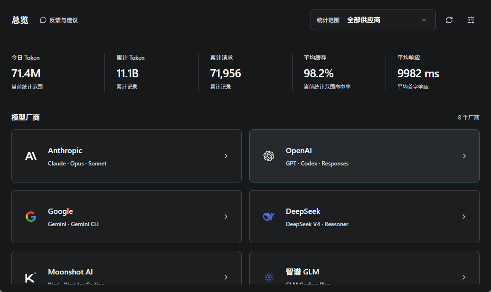
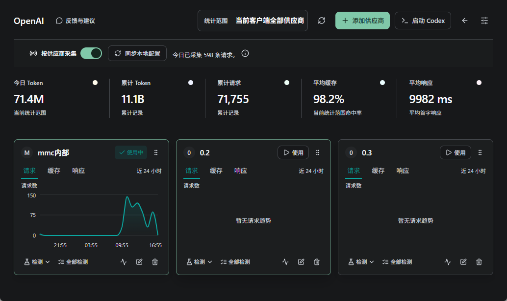
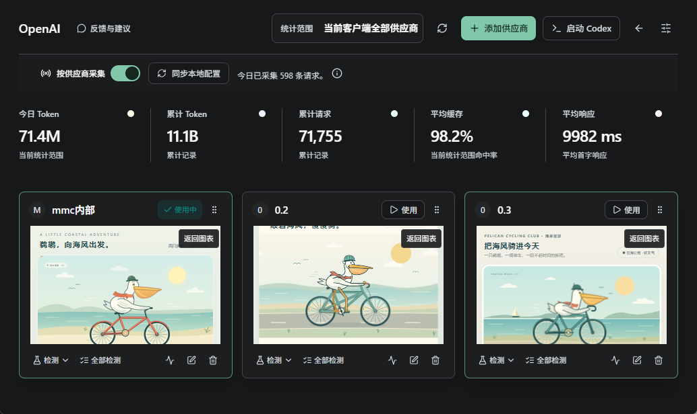

# MMCAPI

### 多供应商管理 · 用量可视化 · Codex 会话管理

把 AI 编程工具的供应商配置、使用数据和历史会话，集中到一个桌面应用中。

[下载最新版本](https://github.com/mmcapi/mmcapi-releases/releases/latest) · [查看更新记录](https://github.com/mmcapi/mmcapi-releases/releases)

---

## 平台与下载

### 1.0.15 正式版（2026 年 11 月 9 日）

首页升级为统一供应商工作区，同一连接可供多个客户端共用；支持同步、搜索和管理模型目录，并为所选客户端分别设置默认模型。聚合供应商可直接应用到客户端，按协议能力提供可用模型，并保护仍在使用的聚合连接。客户端启动与重启入口同步优化，Harness 的聚合配置独立保存，默认模型不会覆盖 Codex 的选择。

**MMCAPI 提供 Windows 和 macOS 版本。** 当前版本的安装包如下：

| 操作系统 | 适用设备 | 可用版本 | 安装包 |
| --- | --- | --- | --- |
| Windows | x64（Intel / AMD 64 位） | **v1.0.15 正式版** | [EXE 安装版（推荐）](https://github.com/mmcapi/mmcapi-releases/releases/download/v1.0.15/mmcapi-v1.0.15-Windows-x64-setup.exe) · [MSI 安装版](https://github.com/mmcapi/mmcapi-releases/releases/download/v1.0.15/mmcapi-v1.0.15-Windows.msi) |
| macOS | Apple Silicon / Intel Mac（通用版） | **v1.0.15 正式版** | [DMG 安装包](https://github.com/mmcapi/mmcapi-releases/releases/download/v1.0.15/mmcapi-v1.0.15-macOS.dmg) |
| Windows | ARM64 | 本次未发布原生安装包 | — |

**Windows x64 和 macOS（Apple Silicon / Intel 通用版）均已更新至 v1.0.15。** Windows 安装包未做商业代码签名。

[查看 1.0.15 更新说明与使用注意事项](https://github.com/mmcapi/mmcapi-releases/releases/tag/v1.0.15)。

平台版本可能分批准备。本表按实际可用包体维护；正式更新清单同时包含 Windows 和 macOS，下载时请以 [Release 附件](https://github.com/mmcapi/mmcapi-releases/releases) 为准。

## MMCAPI 是什么？

MMCAPI（原 mmc-switch）是一款面向 AI 编程工具用户的桌面管理工具。无论你只有一个 API 供应商，还是需要在多个供应商之间切换，都可以在同一个界面管理配置、查看使用趋势，并通过实际生成任务观察模型的输出表现。

应用首页统一管理供应商，支持将同一连接应用到多个客户端，按客户端设置默认模型，并配置、启动本机 Codex、Claude 等客户端。还可管理 Codex 历史会话、查看使用记录，或将多个 API 供应商聚合为统一接入入口。原有按 OpenAI、Anthropic、Google 分类的高级界面仍可从设置进入。

## 界面预览

以下截图展示旧版总览与供应商高级界面；v1.0.15 首页已改为统一供应商工作区，原有高级界面可从设置进入。

### 主页总览

集中查看 Token 用量、累计请求、缓存命中率和平均首字响应时间，从模型厂商入口进入对应的供应商管理页面。

### 每家供应商，独立查看趋势

供应商以独立卡片展示，可切换请求、缓存和响应趋势；配置切换、检测和编辑入口集中在卡片内。

### 同一个任务，直观看到不同输出

通过单家或全部检测，让供应商生成鹈鹕骑自行车的 SVG 动画。生成结果在各自卡片中展示，到时自动恢复图表，也可点击“返回图表”手动切回。

*以上为实际界面截图。用量数据和生成内容仅展示截图时的状态；动画在软件中播放，此处为静态截图。*

## 主要功能

| 功能 | 你可以做什么 |
| --- | --- |
| **统一供应商工作区** | 在首页管理多个供应商的接口地址、密钥和模型配置，同一连接可供多个客户端共用；原有高级界面可从设置进入。 |
| **模型目录与客户端默认模型** | 添加供应商后同步模型目录，搜索和管理启用模型，并为所选客户端分别设置默认模型。 |
| **使用数据总览** | 查看累计请求、缓存命中率和平均首字响应时间，了解当前统计范围内的使用情况。 |
| **每家供应商独立图表** | 分别查看请求、缓存和响应时间趋势，观察不同供应商的实际表现。 |
| **客户端配置与启动** | 将供应商应用到所选客户端，并通过启动、重启入口加载配置；多个客户端的应用结果分别反馈。 |
| **Claude 桌面端配置与启动** | 同步供应商的 API 和模型配置并打开本机 Claude 桌面客户端。 |
| **Harness 独立配置** | Harness 的聚合配置独立保存，设置默认模型时不会覆盖 Codex 的选择。 |
| **聚合供应商** | 将多个 API 供应商组合为统一的接入地址和 Key，直接应用到客户端，并按协议能力提供可用模型；按请求模型和供应商优先级选择来源，同一优先级内随机分配。 |
| **聚合连接保护** | 客户端仍在使用聚合时，阻止移除最后一个成员或拆分全部成员，避免现有连接失效。 |
| **按需共享到局域网** | 为聚合入口开启局域网共享，选择或刷新本机地址；共享默认关闭。 |
| **单家 / 批量动画检测** | 选择检测项目与模型后手动开始检测，在卡片中直接预览结果；批量检测入口位于顶部更多菜单。 |
| **供应商自动检测** | 各供应商可独立设置检测间隔，并保存检测项目、模型和推理强度；确认后才会启用，关闭后停止后续定时请求。 |
| **检测模型与高级选项** | 手动输入或刷新可用模型，并可在高级选项中设置推理强度和结果展示时长。 |
| **自定义结果展示时长** | 检测结果默认展示 1 分钟，可调整展示时长，也可手动返回数据图表。 |
| **Codex 历史会话管理** | 预览本机历史对话、导出备份，并在客户端继续会话。支持本机 API 与账号登录模式的会话衔接。 |
| **会话删除保护与回收站** | 对成功备份的会话提供恢复入口，帮助找回误删内容。 |
| **应用内反馈** | 点击主页或供应商页面的“反馈与建议”，扫码加入交流群。 |

> 数据图表反映应用实际采集到的请求，不代表供应商账户的全部用量。动画检测会产生 API 用量，结果用于直观体验，不是标准化模型评分。

## 下载与安装

按上方下载表选择对应平台的安装包，或进入对应版本的 Release 页面，展开 **Assets（附件）** 下载。Windows x64 和 macOS 当前均为 v1.0.15。

- **Windows x64**：推荐下载以 `Windows-x64-setup.exe` 结尾的安装程序；需要 MSI 格式时，选择 `Windows.msi`。
- **macOS（Apple Silicon / Intel）**：下载 `macOS.dmg`，打开后将 MMCAPI 拖入“应用程序”文件夹。上方下载表提供已发布版本的直接入口。
- `.sig`、`latest.json` 和 `SHA256SUMS.txt` 是更新签名、更新清单及校验文件，无需手动安装。

已有旧版的 Windows 用户，建议保存工作并退出应用，再运行新安装包。安装器沿用旧版升级迁移流程；重要配置和历史会话建议提前备份。

## 开始使用

1. **添加供应商**：在首页供应商工作区填写供应商提供的接口地址和 API Key，同一连接可供多个客户端共用。
2. **管理模型**：同步供应商模型目录，搜索并启用所需模型，为所选客户端分别设置默认模型。
3. **应用到客户端**：点击“使用”将配置应用到相应客户端，再启动客户端开始对话。模型目录更新后，需要再次点击“使用”，必要时重启客户端加载配置。
4. **使用聚合供应商**：需要统一接入多个供应商时，创建聚合供应商并应用到客户端；使用期间保持 MMCAPI 运行。
5. **查看使用与检测结果**：从供应商详情查看使用记录；需要查看原有图表或运行动画检测时，可从设置进入高级界面。
6. **管理历史对话**：在设置中的历史会话入口预览、备份和继续本机 Codex 会话。

一键启动需要本机已安装对应的 Codex 或 Claude 桌面客户端。应用 Claude 配置时，已运行的 Claude 会重启，请先结束正在进行的任务；使用本地路由期间请保持 MMCAPI 运行。供应商地址、密钥和可用模型由对应供应商提供；获取到的模型列表不保证每家供应商都支持同一个模型 ID。

聚合请求会消耗所选供应商的 API 额度，且不会自动替换模型。局域网共享仅适用于可信网络，开启后需要服务电脑与 MMCAPI 持续运行，请妥善保管接入 Key。

## 更新方式

应用内打开 **设置 → 通用 → 版本更新**，检查并按提示下载、安装更新。也可以从本仓库下载对应平台的新安装包进行升级。

每个版本的新增功能、修复内容和平台范围，见 [Release 更新说明](https://github.com/mmcapi/mmcapi-releases/releases)。

**更新公告约定**：Release 正文与应用内更新公告使用同一份纯文本内容，默认不按 Windows/macOS 分章，仅平台专属功能或注意事项单独说明。正式 latest.json 同时包含 Windows 和 macOS；本页下载表按真实可用的版本、架构及包体维护。

## 关于会话同步与恢复

- 会话管理面向**本机 Codex 历史**，不将会话同步到 ChatGPT 网页或其他设备。
- API 与账号登录模式之间可衔接本机会话；遇到跨供应商不兼容的记录，可创建保留可见问答的继续副本。
- 自动删除保护在 MMCAPI 运行期间生效。回收站可以恢复已成功备份的内容，无法保证找回从未备份、已经删除的会话。

## 反馈与建议

在应用主页或供应商页面点击 **“反馈与建议”**，扫描弹出的二维码加入 MMCAPI 交流群。

反馈问题时，建议附上应用版本、操作系统、复现步骤和截图，方便定位。请遮挡 API Key、账号信息和对话中的私人内容。

---

本仓库用于发布 **MMCAPI 安装包、更新签名和版本说明**。源码在独立仓库维护。
